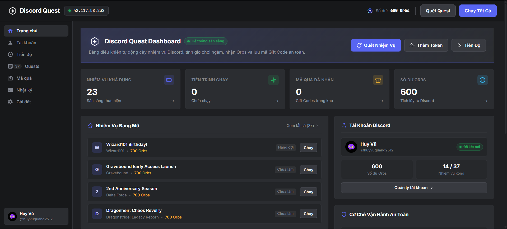

<div align="center">

# Discord Quest

**Tự động hóa tiến trình nhiệm vụ, đồng bộ Orbs và quản lý phần thưởng Discord**

[](https://developer.mozilla.org/en-US/docs/Web/JavaScript)
[](https://vitejs.dev/)
[](https://www.w3.org/Style/CSS/)
[](https://discord.com/developers/docs/intro)
[](https://vercel.com/)
[](./LICENSE)

[](https://github.com/huyvu2512/discord-quest/stargazers)
[](https://github.com/huyvu2512/discord-quest/forks)
[](https://github.com/huyvu2512/discord-quest/issues)
[](https://github.com/huyvu2512/discord-quest/commits/main)


[Xem Website](https://discord.huyvu2512.io.vn/) · [Báo Lỗi](https://github.com/huyvu2512/discord-quest/issues) · [Yêu Cầu Tính Năng](https://github.com/huyvu2512/discord-quest/issues)

</div>

---

<div align="center">
  
</div>

---

## Giới thiệu
Discord Quest là ứng dụng hỗ trợ tự động hóa tiến trình nhiệm vụ, đồng bộ số dư Orbs và quản lý kho phần thưởng Discord trực tiếp trên nền tảng trình duyệt và API serverless. Sản phẩm được thiết kế và phát triển bởi Huy Vũ (@huyvu2512) với mục tiêu nghiên cứu chuyên sâu về cơ chế quản lý phiên, giao thức truyền thông web và tối ưu hóa trải nghiệm người dùng.

Hệ thống hỗ trợ quét kho nhiệm vụ chính thức từ Discord qua API Serverless đa nền tảng, tự động phân loại nhiệm vụ Xem Video (WATCH_VIDEO), Chơi Game trên PC (PLAY_ON_DESKTOP), Livestream và Console. Bằng cách gửi các gói tin nhịp tim (heartbeat) tương thích chuẩn Discord Client, hệ thống giúp tích lũy tiến trình chính xác, hỗ trợ hàng đợi tự động và cung cấp lối tắt mở trang nhận quà trực tiếp trên Discord an toàn, tiện lợi.

---

## Tính năng chính
- Quét nhiệm vụ đa nền tảng - Đồng bộ toàn bộ nhiệm vụ từ Discord Desktop, Web Quest Home, Mobile (Android/iOS) và Decision Engine với hơn 40 request song song.
- Dữ liệu thời gian thực - 100% dữ liệu nạp trực tiếp từ Discord API chính thức, không lưu cache cũ, đảm bảo đồng nhất tuyệt đối giữa các thiết bị.
- Giả lập tiến trình tự nhiên - Tích hợp cơ chế gửi nhịp tim heartbeat chuẩn Discord Client cho game PC và gửi mốc thời gian kèm jitter ngẫu nhiên cho nhiệm vụ video.
- Kiểm tra trạng thái nghiêm ngặt - Xác thực tiến trình trực tiếp từ máy chủ Discord trước khi đánh dấu hoàn thành, ngăn chặn hoàn toàn tình trạng báo ảo 100%.
- Hàng đợi tự động tuần tự - Hỗ trợ chế độ Chạy Tất Cả với hàng đợi thông minh, tự động chuyển tiếp nhiệm vụ kế tiếp ngay khi nhiệm vụ hiện tại hoàn tất.
- Trích xuất Gift Code tự động - Nhận diện và bóc tách mã quà tặng từ các nhiệm vụ game đối tác, lưu trữ an toàn trong kho mã để sử dụng bất cứ lúc nào.
- Quản lý đa tài khoản - Dễ dàng thêm, kiểm tra tính hợp lệ và chuyển đổi linh hoạt giữa nhiều tài khoản Discord mà không cần đăng nhập lại.
- Lưu trữ cục bộ an toàn - Toàn bộ token và thông tin tài khoản chỉ được lưu trong localStorage của trình duyệt, không lưu trữ trên bất kỳ server trung gian nào.
- Giao diện tối ưu - Thiết kế giao diện nền tối (Dark mode) hiện đại, hỗ trợ đầy đủ hiệu ứng chuyển động và tương thích mượt mà trên cả máy tính lẫn điện thoại.
- Theo dõi hệ thống - Tích hợp sẵn Vercel Web Analytics và Speed Insights để theo dõi lưu lượng truy cập và chỉ số hiệu năng trang web.

---

## Công nghệ
| Thành phần | Công nghệ |
| :--- | :--- |
| Frontend | HTML5, Vanilla JavaScript (ES6 Modules) |
| Styling | Vanilla CSS3 (Dark Theme, Glassmorphism) |
| Build Tool | Vite 6 |
| Backend Serverless | Node.js (Vercel Serverless Functions) |
| Giao thức | Discord API v9 Protocol |
| Triển khai | Vercel Edge Network |

---

```text
discord-quest/
├── api/                          # Vercel Serverless Functions
│   ├── auth/                     # Xác thực, làm mới, đăng xuất tài khoản
│   │   ├── logout.js
│   │   ├── refresh.js
│   │   └── verify.js
│   ├── discord-client.js         # Module cấu hình chung: Build Number, Headers, Client State
│   ├── ip.js                     # Xác định địa chỉ IP mạng
│   └── quests/                   # Xử lý nhiệm vụ: Quét, nhận, gửi nhịp tim, lấy gift code
│       ├── enroll.js
│       ├── index.js
│       ├── lookup.js
│       ├── progress.js
│       └── reward-code.js
├── assets/                       # Ảnh chụp màn hình và tài nguyên minh họa
├── css/                          # Hệ thống stylesheet Dark Theme
├── js/                           # Mã nguồn JavaScript phía client
│   ├── main.js                   # Điều phối giao diện và vòng lặp tiến trình
│   ├── state.js                  # Quản lý trạng thái và lưu trữ localStorage
│   └── views/                    # Các module hiển thị (Accounts, Quests, Rewards)
├── public/                       # Tài nguyên tĩnh, favicon, sitemap và preview
│   ├── favicon.ico               # Favicon chuẩn
│   ├── preview.png               # Ảnh xem trước giao diện ứng dụng
│   ├── robots.txt                # Cấu hình robot tìm kiếm
│   └── sitemap.xml               # Sơ đồ trang web phục vụ SEO
├── docs/                         # Tài liệu kỹ thuật
│   └── API.md                    # Tài liệu đặc tả API Serverless
├── index.html                    # Giao diện người dùng chính
├── package.json                  # Cấu hình dự án và dependencies
├── vercel.json                   # Cấu hình định tuyến và Security Headers
├── vite.config.js                # Cấu hình dev server và middleware
├── SECURITY.md                   # Chính sách bảo mật và quy trình báo lỗi
├── LICENSE                       # Giấy phép mã nguồn mở MIT
└── README.md                     # Tài liệu hướng dẫn dự án
```

---

### Yêu cầu môi trường
- Node.js phiên bản 18 trở lên (khuyên dùng Node.js 20 LTS)
- Trình quản lý gói npm phiên bản 9 trở lên

### Cài đặt và vận hành
```bash
# 1. Clone kho mã nguồn
git clone https://github.com/huyvu2512/discord-quest.git
cd discord-quest

# 2. Cài đặt các gói thư viện
npm install

# 3. Chạy server phát triển
npm run dev

# Mở trình duyệt tại: http://localhost:3000
```

---

## Triển khai Vercel
1. Đẩy mã nguồn dự án lên kho lưu trữ GitHub cá nhân.
2. Đăng nhập vào Vercel Dashboard và chọn Add New Project.
3. Chọn repository `discord-quest`.
4. Hệ thống Vercel sẽ tự động nhận diện cấu hình thông qua `vercel.json` hoặc `package.json`.
5. Nhấn Deploy để hoàn tất quy trình triển khai.
6. Truy cập mục Analytics và Speed Insights trên Vercel để kích hoạt hệ thống đo lường lưu lượng và tốc độ trang.

---

## API Overview
Hệ thống cung cấp các endpoint backend phục vụ xác thực và xử lý nhiệm vụ. Chi tiết xem tại [docs/API.md](./docs/API.md):

| Endpoint | Method | Mô tả |
| :--- | :--- | :--- |
| `/api/ip` | GET | Nhận diện địa chỉ IP và nhà mạng đang kết nối |
| `/api/auth/verify` | POST | Xác thực token Discord và kiểm tra thông tin hồ sơ |
| `/api/auth/refresh` | POST | Làm mới thông tin tài khoản và kiểm tra lại token |
| `/api/auth/logout` | POST | Đăng xuất phiên làm việc |
| `/api/quests` | GET/POST | Quét danh sách toàn bộ nhiệm vụ và số dư Orbs |
| `/api/quests/enroll` | POST | Ghi danh nhận nhiệm vụ trên Discord |
| `/api/quests/progress` | POST | Gửi nhịp tim (heartbeat) hoặc tiến độ video |
| `/api/quests/lookup` | POST | Tra cứu thông tin nhiệm vụ theo link hoặc ID |
| `/api/quests/reward-code` | POST/GET | Trích xuất Gift Code của các nhiệm vụ đã hoàn thành |

---

## Tài liệu
| Tài liệu | Nội dung |
| :--- | :--- |
| [docs/API.md](./docs/API.md) | Tài liệu API Reference chi tiết: request/response schema, rate limiting và fallback |
| [SECURITY.md](./SECURITY.md) | Chính sách bảo mật, xử lý dữ liệu và quy trình báo cáo lỗ hổng |
| [LICENSE](./LICENSE) | Giấy phép mã nguồn mở MIT |

---

## Tuyên bố miễn trừ trách nhiệm
Dự án này được tạo ra hoàn toàn vì mục đích học tập, nghiên cứu về cơ chế quản lý phiên và kiến trúc API mang tính chất phi thương mại. Dự án không liên kết, không được tài trợ và không đại diện cho Discord Inc. Tên gọi, thương hiệu "Discord" và các nhãn hiệu liên quan thuộc quyền sở hữu của Discord Inc.

Mọi hành vi sử dụng công cụ này vào mục đích trái phép, xâm phạm tài khoản hoặc gây tổn hại tới hệ thống của bên thứ ba đều bị nghiêm cấm. Người sử dụng phải tự chịu hoàn toàn trách nhiệm pháp lý trước mọi hành vi và hậu quả phát sinh từ việc sử dụng mã nguồn này. Tác giả hoàn toàn không chịu bất kỳ trách nhiệm nào liên quan đến việc sử dụng sai mục đích của người dùng.

---

## Giấy phép
Mã nguồn được phát hành theo giấy phép [MIT License](./LICENSE).
