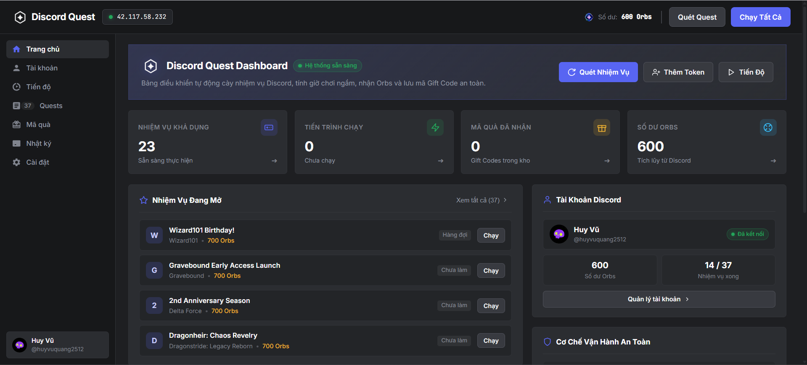

<div align="center">

# Discord Quest

**Automate Discord Quests, Orbs, gift codes, HypeSquad, and game playtime badges**

[](https://developer.mozilla.org/en-US/docs/Web/JavaScript)
[](https://vitejs.dev/)
[](https://www.w3.org/Style/CSS/)
[](https://discord.com/developers/docs/intro)
[](https://vercel.com/)
[](./LICENSE)

[](https://github.com/huyvu2512/discord-quest/stargazers)
[](https://github.com/huyvu2512/discord-quest/forks)
[](https://github.com/huyvu2512/discord-quest/issues)
[](https://github.com/huyvu2512/discord-quest/commits/main)


[Live Website](https://discord.huyvu2512.io.vn/) · [Report Bug](https://github.com/huyvu2512/discord-quest/issues) · [Request Feature](https://github.com/huyvu2512/discord-quest/issues) · [Tiếng Việt](README.vi.md)

</div>

---

<div align="center">
  
</div>

---

## Overview
Discord Quest is a web application for automating Discord Quest progress, syncing Orbs balances, and managing reward gift codes directly from the browser backed by serverless APIs. Designed and built by Huy Vu (@huyvu2512) to explore session management, web communication protocols, and modern responsive UX.

The system scans official Discord Quests across Desktop, Web Quest Home, Mobile (Android/iOS), and Decision Engine endpoints, automatically classifying `WATCH_VIDEO`, `PLAY_ON_DESKTOP`, `STREAM_ON_DESKTOP`, and console quests. By dispatching Discord Client–compatible heartbeats and timestamps, it tracks progress accurately, supports sequential auto-queuing, and provides direct shortcuts to claim rewards safely on Discord.

---

## Key Features
- **Multi-Platform Quest Scanning** — Syncs all quests across Discord Desktop, Web Quest Home, Mobile (Android/iOS), and Decision Engine with 40+ parallel requests.
- **Real-Time Data** — 100% live data fetched directly from official Discord APIs with no stale caching, ensuring consistency across devices.
- **Natural Progress Simulation** — Sends Discord Client–compatible heartbeats for PC games and jittered timestamp milestones for video quests.
- **Strict Completion Verification** — Verifies server-side progress directly with Discord before marking any quest completed, preventing false 100% reports.
- **Sequential Auto-Queue** — Supports *Run All* mode with a smart queue that automatically advances to the next quest once the current one finishes.
- **Automatic Gift Code Extraction** — Detects and extracts reward codes from partner game quests, saving them locally for anytime access.
- **Multi-Account Management** — Easily add, validate, and switch between multiple Discord accounts without re-logging in.
- **Discord Badges & HypeSquad Manager** — Inspect all owned/unlocked profile badges and join or switch HypeSquad Houses (Bravery, Brilliance, Balance) in 1 click.
- **Playtime & Game Variety Badge Runner** — Sends per-game telemetry via the Discord Science API (with session-synced `X-Super-Properties` and `executable_fingerprint`) to level up Game Time (5,000+ hours) and Game Variety (100+ games) badges, locked against running concurrently with Quests.
- **Sync on Pause** — Automatically flushes accumulated playtime to Discord when pausing or stopping all tasks to prevent second drift.
- **Safe Local Storage** — All tokens and account data are stored strictly in browser `localStorage`, never persisted on any intermediary server.
- **Optimized Dark UI** — Modern dark-mode interface with smooth animations, header counters for total completed Quests (from the Quest badge) and Orbs balance, uncompleted-quest sidebar counter, unified page reload button, and clean mobile responsiveness.
- **Observability** — Built-in Vercel Web Analytics and Speed Insights integration.

---

## Tech Stack
| Layer | Technology |
| :--- | :--- |
| Frontend | HTML5, Vanilla JavaScript (ES6 Modules) |
| Styling | Vanilla CSS3 (Dark Theme, Glassmorphism) |
| Build Tool | Vite 6 |
| Serverless Backend | Node.js (Vercel Serverless Functions) |
| Protocol | Discord API v9 |
| Deployment | Vercel Edge Network |

---

## Project Structure
```text
discord-quest/
├── api/                          # Vercel Serverless Functions
│   ├── auth/                     # Authentication, refresh, logout
│   │   ├── logout.js
│   │   ├── refresh.js
│   │   └── verify.js
│   ├── badges/                   # Profile Badges & Discord Science Telemetry
│   │   ├── games.js              # Filter valid Windows games from Discord CDN
│   │   ├── hypesquad.js          # Fetch profile badges, join / leave HypeSquad
│   │   └── science.js            # Dispatch launch_game & running_game_heartbeat events
│   ├── quests/                   # Quest scanning, enrolling, heartbeat, reward codes
│   │   ├── enroll.js
│   │   ├── index.js
│   │   ├── lookup.js
│   │   ├── progress.js
│   │   └── reward-code.js
│   └── ip.js                     # Detect client IP and ISP
├── lib/                          # Shared modules (excluded from Serverless count)
│   ├── discord-client.js         # Build Number, Headers, Client State
│   └── logger.js                 # Standardized server logger
├── assets/                       # Screenshots and media assets
├── css/                          # Modular Dark Theme stylesheets
│   ├── base/                     # Responsive breakpoints
│   ├── components/               # Base components, skeleton shimmer, settings
│   ├── views/                    # Home, Badges, Badge Modal, Playtime Runner
│   ├── layout.css
│   ├── modal.css
│   └── variables.css
├── js/                           # Modular client-side JavaScript
│   ├── controllers/              # Counters, Nav, Queue, Settings, Sync, Token
│   ├── utils/                    # IP, Log, PWA, Skeleton, Toast
│   ├── views/                    # Accounts, Badges/, Home, Logs, Playtime/, Quests, Rewards
│   ├── main.js                   # App bootstrapper
│   └── state.js                  # Core state & localStorage management
├── public/                       # Static assets, HypeSquad icons, favicon, sitemap
├── docs/                         # Technical documentation
│   └── API.md                    # Serverless API specification
├── index.html                    # Main application entry
├── package.json                  # Project config and dependencies
├── vercel.json                   # Routing and Security Headers config
├── vite.config.js                # Dev server, API middleware, and logger config
├── SECURITY.md                   # Security policy and vulnerability reporting
├── LICENSE                       # MIT License
├── README.md                     # Project documentation (English)
└── README.vi.md                  # Project documentation (Vietnamese)
```

---

### Prerequisites
- Node.js 18+ (Node.js 20 LTS recommended)
- npm 9+

### Installation & Local Development
```bash
# 1. Clone the repository
git clone https://github.com/huyvu2512/discord-quest.git
cd discord-quest

# 2. Install dependencies
npm install

# 3. Start the development server
npm run dev

# Open in browser: http://localhost:3000
```

---

## Deploying to Vercel
1. Push the repository to your GitHub account.
2. Sign in to the Vercel Dashboard and click **Add New Project**.
3. Select the `discord-quest` repository.
4. Vercel automatically detects the configuration via `vercel.json` and `package.json`.
5. Click **Deploy** to finish.
6. Enable **Analytics** and **Speed Insights** in your Vercel project settings for traffic and performance metrics.

---

## API Overview
The backend exposes serverless endpoints for authentication, quests, badges, and telemetry. See [docs/API.md](./docs/API.md) for full schemas:

| Endpoint | Method | Description |
| :--- | :--- | :--- |
| `/api/ip` | GET | Detect client IP address and ISP |
| `/api/auth/verify` | POST | Validate Discord token and fetch profile info |
| `/api/auth/refresh` | POST | Refresh account profile and verify token |
| `/api/auth/logout` | POST | End current session |
| `/api/quests` | GET/POST | Scan all available quests and Orbs balance |
| `/api/quests/enroll` | POST | Enroll in a Discord Quest |
| `/api/quests/progress` | POST | Send game heartbeat or video progress |
| `/api/quests/lookup` | POST | Look up quest details by URL or ID |
| `/api/quests/reward-code` | POST/GET | Extract Gift Codes from completed quests |
| `/api/badges/hypesquad` | GET/POST/DELETE | Fetch profile badges, join or leave a HypeSquad House |
| `/api/badges/games` | GET | Fetch valid Windows games from Discord CDN |
| `/api/badges/science` | POST | Send `launch_game` & `running_game_heartbeat` telemetry to Discord |

---

## Documentation
| Document | Description |
| :--- | :--- |
| [docs/API.md](./docs/API.md) | Detailed API Reference: request/response schemas, rate limiting, and fallbacks |
| [SECURITY.md](./SECURITY.md) | Security policy, data handling, and vulnerability disclosure |
| [LICENSE](./LICENSE) | MIT Open Source License |

---

## Disclaimer
This project was created strictly for educational and non-commercial research purposes regarding session management and API architecture. It is not affiliated with, endorsed by, or sponsored by Discord Inc. "Discord" and related trademarks are the property of Discord Inc.

Any unauthorized use, account compromise, or activity that harms third-party systems is strictly prohibited. Users assume full legal responsibility for all actions and consequences arising from using this source code. The author bears no liability for misuse.

---

## License
Released under the [MIT License](./LICENSE).
